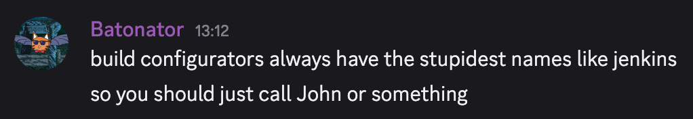

# John

Multi-platform build tool for C and C++ projects.

Supported platforms:

| Platform Name    | Required Host                         | Required Compiler |
| ---------------- | ------------------------------------- | ----------------- |
| `WindowsX64`     | x64 Windows                           | clang             |
| `WindowsX86`     | x64 Windows                           | clang             |
| `LinuxX64`       | x64 Linux, x64 Windows (through WSL2) | clang             |
| `LinuxARM64`     | ARM64 Linux                           | clang             |
| `macOSARM64`     | Apple Silicon macOS                   | Apple Clang       |
| `macOSUniversal` | Apple Silicon macOS                   | Apple Clang       |
| `Web`            | Windows, Linux, macOS                 | Emscripten        |


## Usage

0. Install the following:

    - CMake 4.3+
    - Ninja
    - Visual Studio C++ tools (If compiling for Windows)
    - MSVC v141 tools (14.16), C++ Windows XP Support for VS 2017 (including Windows SDK 7.1A) and Windows SDK 10.0.17763.0 (If compiling for WindowsX86)
    - Clang 19+ (If compiling for Windows or Linux)
    - Apple Clang 17+ (If compiling for macOS)
    - Xcode with `actool` (If compiling a macOS app with `macOS/AppIcon.icon`)
    - `create-dmg`, installed with `brew install create-dmg` (If packaging a macOS app)
    - `linuxdeploy`, downloaded from [its releases](https://github.com/linuxdeploy/linuxdeploy/releases) (If packaging a Linux app)
    - `appimagetool`, downloaded from [its releases](https://github.com/AppImage/appimagetool/releases) (If packaging a Linux app)
    - Emscripten SDK with Emscripten 4.0+ installed and activated (If compiling for Web)
    - Python 3 with the `glad` package, installed with `pip install glad` (If using Glad generation)

    For Linux builds through WSL2, install all this stuff in your WSL distro too. This includes John.

1. Create a `John.json` at your repository's root folder:

    ```json
    {
        // Supported platforms, from the table above
        // Defaults to []
        "platforms": ["WindowsX64", "LinuxX64", "macOSARM64", "Web"],

        // Custom configurations
        // They can be based on either "Debug", "Release", or "RelWithDebInfo"
        // Defaults to {}
        "configurations": {
            "Editor": "Debug",
            "Shipping": "Release"
        },

        // Shared game settings
        // Accepts every field shown in games.MyGame below
        // Defaults to {}
        "defaults": {
            "company": "Awesomesauce Games",
            "variables": {
                "GAME_DEMO": "OFF"
            }
        },

        // Individual games in this project
        // Defaults to {}
        "games": {
            "MyGame": {
                // Base folder for this game's own paths, relative to John.json
                // Defaults to "."
                "directory": ".",

                // Name shown to players
                // Defaults to the CMake target name
                "displayName": "My Awesome Game",

                // Windows metadata description
                // Defaults to the display name
                "description": "An awesome game about awesome things.",

                // Your company name
                // Used in Windows metadata and the macOS bundle identifier
                // Required, either here or in defaults
                "company": "My Company",

                // The game's version number
                // Defaults to "0.0.0"
                "version": "1.0.0",

                // If the game is a command-line program rather than a windowed app
                // On Windows it builds a console executable, so a console window shows up
                // Without this, only Debug and the configurations based on it get a console window
                // On macOS it disables .app packaging
                // Does nothing on other platforms
                // Defaults to false
                "cli": false,

                // John variables, which become CMake target properties and C/C++ macros
                // JOHN_TARGET, JOHN_DISPLAY_NAME, JOHN_COMPANY_NAME, JOHN_DESCRIPTION, JOHN_VERSION, JOHN_PLATFORM, and JOHN_METADATA_DIR are built-in John variables all games have
                // Defaults to {}
                "variables": {
                    "GAME_DEMO": "ON",
                    "GAME_MAX_PLAYERS": "4",
                    "GAME_SAVE_FOLDER": "\"saves\""
                },

                // Files and folders staged with the game
                // Defaults to []
                "resources": [
                    {
                        // The file or directory to copy, relative to the game's own directory
                        // You can use patterns like "Data/**/*.png" too
                        // Paths can use {platform}, {category} (Desktop, Web, or Console), {config}, and {configKind} (Debug or Release)
                        // Required, unless create is set
                        "from": "Data",

                        // Destination path, relative to the game's resource folder
                        // Directories don't get copied as is, but rather dump their contents, so if you want the folder to be copied as is, just put its name here
                        // Defaults to "" (the resource folder itself)
                        "to": "data",

                        // Skip a missing resource instead of freaking out
                        // Patterns are always optional, regardless of this setting
                        // Defaults to false
                        "optional": false
                    },
                    {
                        // Create an empty folder instead
                        // This is also relative to the game's resource folder
                        "create": "saves"
                    }
                ]
            }
        },

        // Games from other projects to run during builds and packaging
        // Arguments can use {platform}, {category}, {config}, and {configKind}, like the resources
        // Defaults to {}
        "hooks": {
            // Before each build
            // Defaults to []
            "preBuild": [
                {
                    // The name of the game in the other project
                    // Required
                    "name": "Packer",

                    // The other project's folder, relative to John.json
                    // Required
                    "project": "Tools",

                    // The configuration you wanna use when building it
                    // Defaults to "Release"
                    "configuration": "Debug",

                    // The arguments you wanna pass on
                    // Defaults to []
                    "arguments": ["Assets", "Packed/{configKind}"]
                }
            ],

            // After each build
            // Defaults to []
            "postBuild": [],

            // Before packaging
            // Defaults to []
            "prePackage": [],

            // After packages actually exist
            // Defaults to []
            "postPackage": []
        },

        // Glad loader generation
        // Skipped when omitted
        "glad": {
            // Required APIs and versions
            // Required
            "api": "gl=2.1,gles2=2.0",

            // Either "core" or "compatibility"
            // Defaults to "compatibility"
            "profile": "compatibility",

            // Output folder, relative to John.json
            // Defaults to "Libraries/glad"
            "output": "Libraries/glad",

            // Comma-separated extensions
            // Defaults to ""
            "extensions": ""
        }
    }
    ```

2. Call `john_add_game` in `CMakeLists.txt` for each game:

    ```cmake
    john_add_game(MyGame SOURCES Main.cpp)
    ```

    Including the sources in `john_add_game` is optional, you can add them later with `target_sources`, as you'd normally do with CMake.

    John takes over your `CMakeLists.txt` with its own, so you don't need to add your own `cmake_minimum_required` or `project`. This means that `CMAKE_SOURCE_DIR` points to John's build folder, _not_ your repository. Use `CMAKE_CURRENT_SOURCE_DIR` or `PROJECT_SOURCE_DIR` instead.

    `JOHN_PLATFORM`, `JOHN_WINDOWS`, `JOHN_LINUX`, `JOHN_MACOS`, `JOHN_WEB`, `JOHN_DESKTOP`, and `JOHN_CONSOLE` are built-in as both CMake variables and C/C++ macros, and `JOHN_DEBUG`, `JOHN_RELEASE`, and `JOHN_RELWITHDEBINFO` as C/C++ macros only.

    To read a game's John variables, use `get_target_property`:

    ```cmake
    get_target_property(game_version MyGame JOHN_VERSION)
    get_target_property(game_demo MyGame GAME_DEMO)
    ```

3. Add the platform metadata to a `Metadata` folder in the game's directory:

    - `Metadata/Windows/AppIcon.ico` (For Windows)
    - `Metadata/macOS/AppIcon.icon`, `Metadata/macOS/Credits.rtf`, and `Metadata/macOS/DMGBackground.png` (For macOS)
    - `Metadata/Linux/AppIcon.png` (For Linux)

    These files are optional, except for the Linux icon, which packaging needs.

4. Grab John from [the releases](https://github.com/MorsGames/John/releases), and run the executable you just downloaded. Follow the instructions, and it should install itself to your machine and appear in your `PATH`. From there, you can run `john` from anywhere and it should work.

5. Run `john run` from your project root. If you set everything up correctly, your game should compile and launch!


## FAQ

### Q: Who is this for?
A: Mostly myself. If you think a project like this is useful for you, feel free to use it! Though, it's intentionally very opinionated in its design, and I'm not planning to change that anytime soon.

### Q: Is this for AI agents?
A: AI agents are great at dealing with the dogshit mess that is CMake, and don't gain much from interactive CLI tools. If you're vibeslopping some project, you won't get much out of John.

### Q: CLI? So like Claude Code?
A: Come on, man.

### Q: Can I trust you, Mors?
A: \*holds your hand\* You can always trust me, babygirl. \*hugs you tight\* Shhhh, don't worry. I'm not going anywhere soon.

### Q: How do I build this?
A: It's a C# .NET 11 project. It doesn't require anything special to build, I'm sure you can figure it out yourself.

### Q: Why is it called John?
A: 
